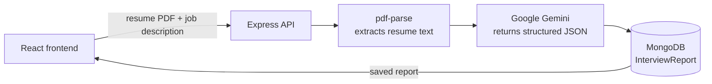

# InterviewAI

**AI-powered interview preparation for a specific job.** Upload your resume, paste the job description, and InterviewAI generates a personalised interview report: how well you match the role, the questions you are likely to be asked (with model answers), your skill gaps, and a day-by-day preparation plan. It can also generate a tailored, ATS-friendly resume as a PDF.

Built with the MERN stack and Google Gemini.

---

## Features

- **Match score (0–100)** showing how well your profile fits the job description
- **Technical questions** likely to come up, each with the interviewer's intention and a model answer
- **Behavioral questions** with the same intention + answer breakdown
- **Skill gaps** ranked by severity (low / medium / high)
- **Day-by-day preparation road map** with focus areas and tasks for each day
- **Tailored resume PDF**: generates an ATS-friendly resume rewritten for the target job, ready to download
- **Report history**: every report is saved to your account and listed newest first, with the match score colour-coded
- **Authentication**: register, login and logout, with protected pages and API routes

---

## Tech Stack

| Layer | Technologies |
|---|---|
| **Frontend** | React 19, Vite, React Router 7, Axios, Sass, Context API |
| **Backend** | Node.js, Express 5 |
| **Database** | MongoDB with Mongoose |
| **AI** | Google Gemini (`@google/genai`) with structured JSON output |
| **Validation / schemas** | Zod, `zod-to-json-schema` |
| **Auth** | JSON Web Tokens (stored in a cookie), bcryptjs |
| **Files & PDF** | Multer (upload), pdf-parse (resume text extraction), Puppeteer (HTML → PDF) |

---

## How It Works



**Generating a report**

1. The user uploads a resume (PDF), pastes the job description and can add a short self-description.
2. The frontend sends everything as `multipart/form-data`. The auth cookie is sent along automatically.
3. The `authUser` middleware verifies the JWT and checks that the token has not been blacklisted.
4. Multer keeps the uploaded file in memory (max 3 MB). It is never written to disk.
5. `pdf-parse` extracts the text from the resume.
6. The resume text, job description and self-description are sent to Gemini.
7. The report is saved in MongoDB against the logged-in user and returned to the frontend.

**Getting reliable JSON from the AI**

The shape of the report is defined once as a **Zod schema**. That schema is converted to JSON Schema and passed to Gemini as its `responseSchema`, with `responseMimeType: "application/json"`. Because of this, the model must return JSON in exactly that structure, so the response maps directly onto the Mongoose model with no text parsing needed.

**Generating the tailored resume PDF**

1. Gemini writes the tailored resume as HTML, again using a schema.
2. Puppeteer renders that HTML in headless Chromium and prints it to an A4 PDF.
3. The PDF is returned as a file download.
4. The frontend receives it as a `blob` and triggers the download in the browser.

---

## Architecture

**Backend: layered structure**

```
routes → middlewares → controllers → services → models
```

- **Routes** map URLs to handlers.
- **Middlewares** handle authentication and file upload.
- **Controllers** handle the request and response.
- **Services** contain the AI and PDF logic.
- **Models** define the MongoDB schemas.

**Frontend: feature-based structure**

Each feature (`auth`, `interview`) is split into four parts:

- `context`: shared state
- `hooks`: logic
- `services`: API calls
- `pages`: UI

**Data model**

- `users`: username, email, hashed password
- `InterviewReport`: job description, resume text, self-description, match score, title and the owning user. Questions, skill gaps and the preparation plan are stored as **embedded** sub-documents, because they belong to one report and are always read with it. The user is a **reference** (ObjectId), since one user has many reports.
- `blacklistTokens`: tokens invalidated on logout

---

## API Reference

| Method | Endpoint | Access | Description |
|---|---|---|---|
| `POST` | `/api/auth/register` | Public | Register a new user (`username`, `email`, `password`) |
| `POST` | `/api/auth/login` | Public | Log in with `email` and `password` |
| `GET` | `/api/auth/logout` | Public | Clear the auth cookie and blacklist the token |
| `GET` | `/api/auth/get-me` | Private | Get the logged-in user |
| `POST` | `/api/interview/` | Private | Generate a report (`multipart/form-data`: `resume` PDF, `jobDescription`, `selfDescription`) |
| `GET` | `/api/interview/` | Private | List the logged-in user's reports (summary fields only) |
| `GET` | `/api/interview/report/:interviewId` | Private | Get one full report |
| `POST` | `/api/interview/resume/pdf/:interviewReportId` | Private | Generate and download the tailored resume PDF |

---

## Getting Started

### Prerequisites

- Node.js 20.19+ (or 22.12+)
- A MongoDB database: local, or a free cluster on [MongoDB Atlas](https://www.mongodb.com/atlas)
- A Google Gemini API key from [Google AI Studio](https://aistudio.google.com/)

### 1. Clone the repository

```bash
git clone https://github.com/Naveen-Sharma92/InterviewAI.git
cd InterviewAI
```

### 2. Set up the backend

```bash
cd Backend
npm install
```

> `npm install` also downloads a Chromium build, which Puppeteer uses to generate the resume PDF.

Create a `.env` file inside `Backend/`:

```env
MONGO_URI=mongodb://localhost:27017/interviewai
JWT_SECRET=your_jwt_secret
GOOGLE_GENAI_API_KEY=your_gemini_api_key
```

Start the server (runs on `http://localhost:3000`):

```bash
npm run dev
```

### 3. Set up the frontend

Open a second terminal:

```bash
cd Frontend
npm install
npm run dev
```

Open **http://localhost:5173** in your browser. Register an account, upload your resume and paste a job description to generate your first report.

> The frontend expects the API at `http://localhost:3000`, and the backend allows requests from `http://localhost:5173`, so keep these default ports.

---

## Project Structure

```
InterviewAI/
├── Backend/
│   ├── server.js                      # entry point: connects to MongoDB and starts the server
│   └── src/
│       ├── app.js                     # Express app, middleware and routes
│       ├── config/database.js         # MongoDB connection
│       ├── routes/                    # auth.routes.js, interview.routes.js
│       ├── middlewares/               # auth.middleware.js (JWT), file.middleware.js (Multer)
│       ├── controllers/               # auth.controller.js, interview.controller.js
│       ├── services/ai.service.js     # Gemini prompts, Zod schemas, Puppeteer PDF
│       └── models/                    # user, interviewReport, blacklist
│
└── Frontend/
    └── src/
        ├── App.jsx                    # context providers + router
        ├── app.routes.jsx             # page routes
        └── features/
            ├── auth/                  # Login, Register, Protected route, auth context/hook/API
            └── interview/             # Home (create + history), Interview (report view),
                                       # interview context/hook/API, styles
```

<!--
## Screenshots

Add screenshots to a `screenshots/` folder, then remove this comment wrapper.

| Create a report | Interview report |
|---|---|
|  |  |
-->

---

## Roadmap

- Input validation and centralised error handling across all routes
- Stricter cookie security flags (`httpOnly`, `secure`, `sameSite`) and automatic expiry of blacklisted tokens
- Support for DOCX resumes
- Background job queue for AI and PDF generation, so long requests don't block the user
- Automated tests (Jest + Supertest) and deployment

---

## Author

**Naveen Sharma** · [@Naveen-Sharma92](https://github.com/Naveen-Sharma92)
